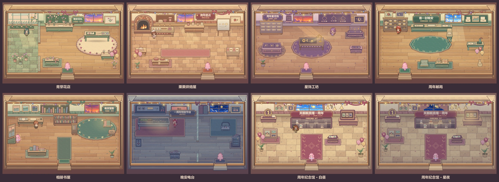
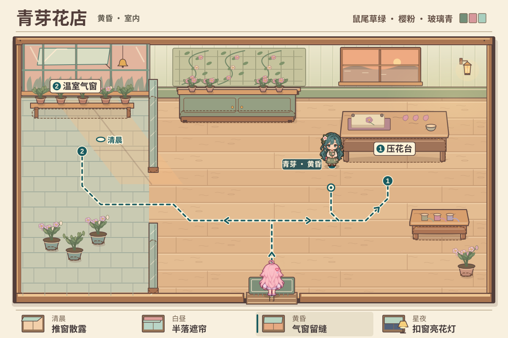
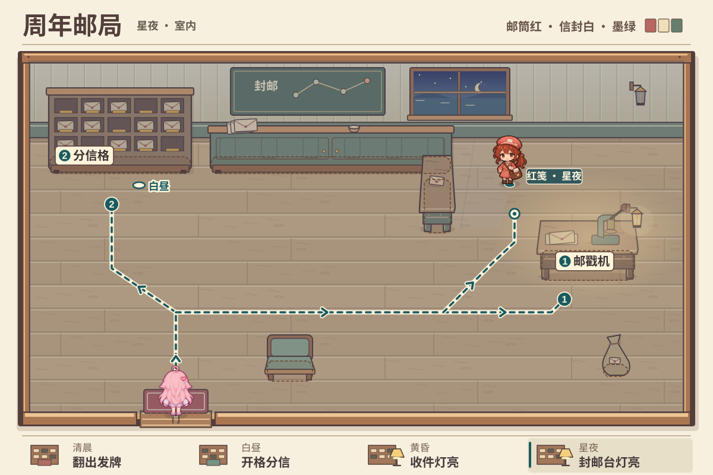
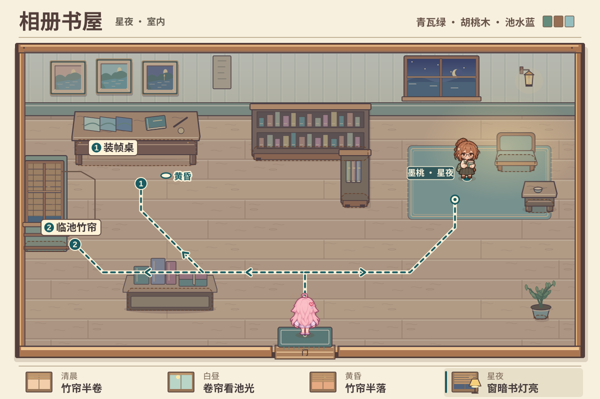

# 晚安周年小镇 · 七栋建筑的室内地图设计稿

新版白昼效果图把晚安小屋与七间店铺并排展示，单张可放大到 1200 × 800。[查看白昼室内美术评审图](town-interiors/daylight-concepts/README.md)

七间屋子全天开放。芙芙可以在花店借一片落花，在邮局给自己盖一枚月牙邮戳，也可以第一次上北坡就进纪念馆。第一次收下一件小物时会盖一枚同名徽章。成品收在 **纪念物 → 小镇小物**，徽章可在周年徽章册的 **探索与彩蛋** 查看。纪念馆的双层展柜按建筑陈列七件小物。

下图取自游戏画布。木纹与布纹取自晚安小屋的原画，陶砖和浅石板使用周年小镇铺石的笔触。房梁、家具的明暗面和黄昏点亮的星星灯串也沿用小屋的画法。花店的釉面花盆与压花台、烘焙屋的单层草莓蛋糕、工坊的成品柜和邮局的月牙火漆信，各自沿用房间配色。书屋把池景收进西墙窗格，电台以靛蓝和莓红绘制设备与坐具，纪念馆用同一套胡桃木色画影箱柜与双层展柜。各屋的墙画依次画着洋桔梗、草莓配方、铜色星月、纪念邮票、池景、晚安磁带和周年花拱与街灯。

[](town-interiors/interiors-in-game.webp)

下方七张室内草图可独立打开。**点图可放大。在浏览器单独打开 SVG 原图后，点图底的清晨、白昼、黄昏或星夜**，可以对照同一间屋子的窗扇、炉火、灯光和居民位置。草图显示代表时段，图底四幅小样可直接对照。纪念馆图顶还可以切换收藏数量。

## 读图与游戏时钟

- 七图共用 **600 × 400** 逻辑坐标，北墙在上，朝南的一面剖开。门垫上的芙芙取自游戏背向站立帧，身高约 43 个地图像素。居民使用各自的原立绘，桌面、椅背、炉口和窗台都以她们的身高定位。
- 青色虚线是从门垫出发的步行路线。**①** 对应主互动，**②** 对应另一处可查看的东西。物件名牌和地面上同号的圆点配对，圆点是芙芙实际停步的位置。人物旁的靶心是独立的交谈点，写着时段的空心椭圆标出这位居民另一班的站位。棕色点划线沿桌脚、柜底和隔断在地面的占地绘制。
- 人物与台柜、阅读椅和展桌按接地位置排序。脚底在物件后方时保留上方轮廓的遮挡，走到前方时人物盖住它。花店隔断和电台玻璃只在底轨处挡脚。玻璃保留透光，隔断开口处可完整看见经过的人物。窗光和灯影铺在场景上，提示和对白绘于上层。
- 沿用世界时钟。清晨为 05:00–08:00，白昼为 08:00–17:00，黄昏为 17:00–20:00，星夜为 20:00–次日 05:00。进门和读档时直接呈现当下时段。自然换班时，窗光与地板投影随现有昼夜过渡，窗扇、炉膛和灯牌各完成一次状态切换。开启减少动态效果时直接显示终态。
- ① 打开工作台后，拖动、按住或旋转图中的道具。用键盘时可聚焦道具，用方向键调整，空格或 Enter 确认，压板需要按住再松开。做完后选择「收下」，背包和展柜会换成这次的款式。收起工作台会结束本次试做，七件都可以在居民外出时取得。

## 青芽花店

[](town-interiors/florist.svg)

鼠尾草绿的窗框从街上的青瓦延伸进店里。西侧温室铺浅绿砖，主屋是干燥的木地板，两种地面在隔断的宽口相接。黄昏的青芽站在压花台左侧，给芙芙留出正面的操作位置。

温室花架插着纸花牌，釉盆里的花有高低不同的茎叶，窗边垂下细藤。进门左手的包扎台放着扎好的花束和两轴缎带，压花台右手的浅盘盛放待用的花瓣。

**① 压花台 · 窗光花签**　把浅紫或奶白的洋桔梗花瓣拖到透光纸上，按住木压板，等压合进度填满再松手。抽出的花签上能看见细细的花脉。青芽初见时赠送的整束洋桔梗另有自己的赠语和收藏位置。

**② 温室气窗**　轻推窗把，听黄铜小铃碰响，看叶影扫过花桶。清晨窗扇大开，玻璃上留露珠。白昼放下半截遮帘，黄昏把窗收至一道缝。星夜扣好窗闩，花架旁亮一盏暖灯。夜里也能推开看一眼，再轻轻扣好。

| 与青芽交谈 | 台词 |
| --- | --- |
| 清晨开场 | “早。你托一下这片叶子，我来推窗。看，露珠顺着叶尖跑到你这边了。” |
| 黄昏开场 | “把花瓣往窗边挪一点。刚才还像一小团紫，迎着光，连最细的那条脉都看得见。” |
| 熟客话题一 | “我小时候压过一朵特别大的花。书合上以后鼓了三天，我娘一眼就猜到是哪本。” |
| 熟客话题二 | “这张纸我特意留了个小角。你用两根手指捏这里，举起来就不会遮住花了。” |

## 栗栗烘焙屋

[](town-interiors/baker.svg)

蜂蜜黄的砖拱包住炉口，奶油色案台紧接出炉的位置。左手能看饼干成形，右手能看栗栗画它的模样。她留给芙芙的第一块草莓蛋糕继续走原有的举板、预留和品尝剧情。

品尝柜旁的格子布垫上摆一张装盒台。一开一合的草莓铁盒放在浅木托盘上，台沿搭着擦手布。砖炉旁的原料罐贴有窄纸签，头顶的木架收着叠盘、搅拌碗和果酱。

**① 压模台 · 草莓饼干铁盒**　把草莓压模拖到面片上，再把装好小饼的托盘推进砖炉。炉铃翻牌后，把小饼拖进铁盒。星夜使用时，砖炉会为这一盘短暂升温，装盒后回到熄炉状态。

**② 手绘白板**　翻板看栗栗的两张速写。清晨是大小不同的面团，炉膛里火苗最高。到了白昼，案台明亮，炉口缩成小火。黄昏铁盘收起，白板多了两颗烤歪的草莓，炉膛剩下红光。星夜能看清炉灰，东墙的灯仍照着白板。

| 与栗栗交谈 | 台词 |
| --- | --- |
| 清晨开场 | （栗栗用手比出一个小圆，又在白板上画了一个大圆。她指指炉门，在两个圆中间添上一支胖箭头。） |
| 黄昏开场 | （栗栗把最后一只盘子摞好，翻出白板。画上的草莓歪向一边，她端详片刻，自己也把帽子歪向了那边。） |
| 熟客话题一 | （栗栗举起一只饼干模。芙芙从中间望过去，正好框住她一只眼睛。白板上慢慢冒出三个字，“看见啦”。） |
| 熟客话题二 | （栗栗把铁盒盖轻敲两下，在白板上画了两枚音符。芙芙跟着敲了一下，她笑着补上第三枚。） |

## 星饰工坊

[](town-interiors/maker.svg)

屋外紫藤的颜色用在软帘和灯罩上。中央工作台铺黑绒，黄铜的亮边在上面一眼可辨。西侧抽屉柜南面是一座玻璃成品柜，陈列月牙挂饰、星形铜片和戒指。沿成品柜东边走可到材料抽屉，中央工作台四周留有通路。

东边的绒布样板架挂着星、月和菱形铜片，下面一层用来摆放小件。黄昏时暖光照在样板上，可与中央试光台的投影对照。

**① 试光台 · 透星铜片**　先把铜片拖进转轴，再沿圆边转动，观察星影沿黑绒移动。星影与月牙刻线对齐时松手。偏开了可以转回来再试。

**② 材料柜**　拉开抽屉，并排看磨过与尚有锤纹的黄铜。清晨卷起百叶借天光，白昼放下柔光布，抬起铜片能看清磨痕。黄昏试光灯亮，星影落在黑绒上。星夜只留工作罩灯，来人仍能试光。

| 与紫凌交谈 | 台词 |
| --- | --- |
| 白昼开场 | “来，借你这边的光。柔光布一放，铜片上哪一圈还没磨匀，眼睛马上就知道了。” |
| 黄昏开场 | “Perfect！站这儿看，台灯一亮，星尖刚好落进月牙。你再转一下，我跟着你的手调灯。” |
| 熟客话题一 | “这只抽屉最会骗人。拉开时叮叮当当，听着像一柜子宝贝，数来数去就三颗扣子。” |
| 熟客话题二 | “试试看，把星星投到我袖口。再抬一毫米——好啦，今天这件围裙也算定做过了。” |

## 周年邮局

[](town-interiors/post.svg)

墨绿柜台在尽头拐一个弯，侧边的开口让红笺和客人可以走到同一张工作桌。信格用黄铜小牌区分邮路，瓦红色的手柄提示哪里可以盖戳。

等候椅和待寄包裹柜共用一块织着信封图案的垫子，柜上叠好系绳的牛皮纸包裹。账册、笔和印垫收在各自的台面上。

**① 邮戳机 · 月牙邮戳明信片**　选一张预印风景片拖到定位框，让邮票角对准槽口。把手柄拉到下面的压线再松开，邮票上就多了一枚月牙戳。红笺寄往晚安小屋的信按原剧情投递。

**② 分信格**　翻木牌看红笺这一班的邮路。清晨牌面翻到“晨邮”，指向出门的路。白昼抽屉敞开，格内露出待分的信。黄昏东侧的收件灯先亮，红笺在街上收信。星夜格柜合好，台灯单独照亮邮戳和待封的信。

| 与红笺交谈 | 台词 |
| --- | --- |
| 白昼开场 | “乖乖，帮我瞧瞧，这两封是不是去了同一条街？一个画的是红邮筒，一个画的是邮筒旁那盆花。” |
| 星夜开场 | “手搁这儿，灯光刚好。晚上盖最后一个戳，我总爱慢一点，好瞧清楚那弯月牙。” |
| 熟客话题一 | “第一次试这台机器，我把月亮盖倒了。收信的人回我一句，说谢谢我寄去了一只小碗。” |
| 熟客话题二 | “乖乖，拿张风景片试试。你看中哪盏街灯，就把邮票贴在它旁边，我替你把月亮添上。” |

## 相册书屋

[](town-interiors/books.svg)

装帧桌摆着摊开的相册、纸样和墨水。后窗的竹帘拉绳沿窗框垂下，树梢和相邻的青瓦屋顶透过玻璃可见。矮书架在东边围出有坐垫和茶几的阅读角。

西南角的矮书箱立着待缝的布面相册，边上摞着夹好书签的书册。东边的阅读椅搭着一条薄毯，装帧桌旁的西侧走廊可以通行。

**① 装帧桌 · 池畔风琴折页**　沿两条虚线先向右折晨光页，再向左折灯下页。捏住外沿拉开，三段水岸连成一条线。背包里也可展开重看。

**② 后窗竹帘**　点北墙上的窗格或拉绳卷起竹帘。清晨屋瓦上带着露光，白昼能看见树梢和青瓦，黄昏檐口泛金，星夜亮起街灯。收下折页后可以在窗边展开，比较两幅街景。

| 与墨桃交谈 | 台词 |
| --- | --- |
| 黄昏开场 | “君来得巧。趁斜光还看得清这道折痕，替我按住这一岸，另一岸便能接上了。” |
| 星夜开场 | “君且坐。方才读到一个‘静’字，窗外的鸟偏偏在那一刻扑了扑翅膀。” |
| 熟客话题一 | “有人问这三幅该从哪边读。我常从亮灯那头开始，慢慢折回去，便又逛了一趟清晨。” |
| 熟客话题二 | “君听过纸说晚安么？慢些合上最后一折。正是这一声，我日日等它收尾。” |

## 晚安电台

[](town-interiors/radio.svg)

月夜蓝的窗框和深红吸音毡围出播音间。芙芙从东侧进门，在玻璃隔断南端绕到调音台。坐回试听椅，还能隔着玻璃看见播出灯和夜神华。

东侧的监听架上放着备用磁带，黄昏和星夜亮起琥珀色指示灯。试听椅的靠背有布纹和滚边，墙上挂着两块吸音毡，调音台与墙边音箱之间沿地板布线。

**① 调音台 · 晚安试播带**　把溪水或檐铃声带拖进第一轨，再把第二轨的推杆推到刻度线。试听时同步显示声轨名称、电平和播出灯，静音也能完成。试听椅可重听最近收下的那条片头。

**② 试听椅**　第一次戴上耳机听台呼，做完试播便可重听自己的片头。清晨台标换成“已收播”，电平落下。白昼显示“待机”。黄昏亮琥珀色“预听”，只有试音电平跳动。星夜红色“播出”亮起，两排电平随节目起伏。

| 与夜神华交谈 | 台词 |
| --- | --- |
| 清晨开场 | “我刚把推子拉下来，窗外那只鸟就接上了。它今天可真准点。” |
| 星夜开场 | “红灯亮了。芙芙，把左边这只耳机戴上，我想让你第一个听见今晚的开场。” |
| 熟客话题一 | “刚才那点沙沙声你也听见了？……呀，小牛角上的丝带又蹭到话筒了。” |
| 熟客话题二 | “刚才留了两拍没说话，想着你会坐过来。你真来了。那这两拍我想留在带子里。” |

## 周年纪念馆

[](town-interiors/hall.svg)

红瓦色展帘下挂着周年花拱和街灯的插画。暖栗以摄影来宾的身份在这里整理街景展览。正门所在位置落在现有建筑碰撞内，入口设在**馆东石阶上平台**。从北街沿石阶上去，在侧门牌前进馆，出馆回到同一级平台。

展厅两侧各留一处观看点。左边的街景展架装裱红瓦街口、临池石桥和灯下广场的插画，右边的小展台托着摊开的周年册。两处陈设之间的地毯直通纪念品展柜。

**① 手摇影箱 · 亮灯夜票根**　沿手柄顺时针累计转满一圈，依次看见空广场、挂上彩旗、街灯初亮三格速写。捏住露出一角的票根，沿标线拉出。把纪念馆作为第一站也能收下它。

**② 小镇纪念品展柜**　展柜贴北墙放置，门垫前的地毯通向柜前。上层从西往东依次是花店、烘焙屋、纪念馆和工坊，下层依次是邮局、相册书屋和电台。柜顶显示收藏数，每格标着建筑名，收下小物后摆出对应的复制品。靠近查看可打开七件纪念品的收藏清单。清晨展帘半开，白昼整扇高窗透光，黄昏先亮展墙的灯，星夜再亮影箱内灯。

| 展柜样稿 | 可见内容 |
| --- | --- |
| 空收藏 | 柜顶显示 0/7，七格各有一件小物的浅色轮廓。芙芙可以直接去影箱取第一张票根。 [查看空收藏](town-interiors/hall.svg#dusk-empty) |
| 三件示例 | 柜顶显示 3/7，花店、邮局和电台三格摆上花签、明信片与试播带。 [查看三件](town-interiors/hall.svg#dusk) |
| 七件齐全 | 柜顶显示 7/7，两层格子都摆着对应的复制品。 [查看七件](town-interiors/hall.svg#night-full) |

| 与暖栗交谈 | 台词 |
| --- | --- |
| 白昼开场 | “芙芙，帮我选一幅街景摆在前面吧。你想先看红瓦街口，还是池边这座石桥？” |
| 黄昏开场 | “等一下，画框还歪一点……好了！快站我这边看，纸上的路灯和窗外那盏刚好接在一起。” |
| 熟客话题一 | “我以前拍广场，总等大家都走开。刚才翻底片才发现，最舍不得收起来的那张里，每个人都在忙自己的事。” |
| 熟客话题二 | “这回你来当摄影师。你要是数到三，我一定会眨眼。要不咱们数到二就拍？” |

## 人物换班与重访

| 居民 | 清晨 | 白昼 | 黄昏 | 星夜 |
| --- | --- | --- | --- | --- |
| 青芽 | 温室开窗 | 花店外 | 屋内压花 | 休息 |
| 栗栗 | 炉边开炉 | 烘焙屋外 | 屋内收盘 | 休息 |
| 紫凌 | 工坊外 | 试光台前打样 | 东侧试灯 | 休息 |
| 红笺 | 街上送信 | 局内分信 | 街上收信 | 局内封晚邮 |
| 墨桃 | 书屋外 | 休息 | 装帧桌边 | 阅读角夜读 |
| 夜神华 | 电台收播 | 休息 | 街上听溪声 | 电台播音 |
| 暖栗 | 街上晨拍 | 馆内选画 | 馆内布展 | 街上夜拍 |

门牌写出当前去向，例如白昼在花店门口能读到“青芽在东边花阶”，黄昏则是“青芽在压花台”。玩家在场时，换班的居民先走到门槛再跨场景，人物、交谈提示和脚底碰撞随人一起交接。正在聊天时保留人物和这一段对白，收起或走远后再换班。已在别处推进时间，进门时便采用当前班次。

屋内外共用人物的相识和赠礼记录。初见、青芽尚未送出的花束、栗栗预留的第一块蛋糕、红笺的投递和夜神华尚未递出的信，依原角色剧情优先接续。进入日常后，每个在场时段第一次闲聊读该时段开场，再次发起分别读熟客话题一、二，随后轮回。返回聊过的时段时接着该班的进度，若刚在另一班听过同一条熟客台词，就轮到下一条。翻页和连点同一段只算一次，刷新后接着已记下的进度。

## 进出门与步行验收

门外两列使用 1536 × 1024 小镇坐标，其余列使用各自的 600 × 400 室内坐标。商铺可朝北跨过正门门槛，也可按 **E**、点击或轻触门。纪念馆的入口是东侧石阶上平台的小木牌，走到牌前按 **E** 或点牌进馆。进屋落在门垫上并面朝北，出门回到同一扇门的街道侧落脚点。室内从门垫向南走到 y = 352 出门，也可点击门垫南侧的出口。南墙两侧挡脚，只有门洞可通过。自动切图只处理朝门外或门内跨过线的一步，站在落脚点和沿门前横向经过时照常通行。

| 建筑 | 街道侧落脚 | 正门门槛或门牌 | 室内门垫 | ① 主互动停步 | ② 次互动停步 |
| --- | --- | --- | --- | --- | --- |
| 青芽花店 | (258, 242) | (258, 232) | (321, 336) | (458, 214) | (97, 179) |
| 栗栗烘焙屋 | (711, 244) | (711, 237) | (400, 336) | (157, 190) | (480, 183) |
| 星饰工坊 | (1213, 403) | (1213, 395) | (274, 336) | (289, 257) | (93, 185) |
| 周年邮局 | (253, 627) | (253, 621) | (148, 336) | (475, 252) | (94, 172) |
| 相册书屋 | (852, 767) | (852, 756) | (305, 336) | (141, 184) | (442, 136) |
| 晚安电台 | (1337, 829) | (1337, 824) | (462, 336) | (139, 205) | (485, 211) |
| 周年纪念馆 | (1188, 54) | (1178, 49) | (300, 336) | (476, 180) | (300, 198) |

草图按游戏的脚底半径 5 验线。新落脚点和门槛之间留一步，书屋回到台阶西侧，和墨桃的巡走路线错开。把当班人物放进草图后，从门垫走到两个操作点和独立交谈点，再原路走到门槛。另试走南墙、柜台、桌脚和两处玻璃隔断的实体部分。纪念馆按空收藏、三件和七件复核格内小物、柜顶计数和清单。

美术取色对照小镇屋顶与店招，室内比例取自晚安小屋。草图中嵌有项目的芙芙、镇民和夜神华立绘，柜台、家具、小物与光照为本稿绘制。 [周年小镇底图](../../src/assets/anniversary-town-v13.webp) · [晚安小屋底图](../../src/assets/room-interactive.webp) · [居民美术记录](ARTWORK-residents.md)

## 实机美术源文件

`scripts/town-interior-finish.mjs` 绘制地板、壁板和织物，`scripts/town-interior-furnishings.mjs` 绘制桌台、器物与背墙陈设。桌上的小物跟随承托家具的深度层，墙上的陈设绘在背墙层。`node scripts/build-town-interiors.mjs` 读取草图的占地和对白，再合成各屋的 WebP 图集。

早期的内置 ImageGen 美术试样继续收录在设计档案中。 [柜台与道具试样](town-interiors/dressing-atlas.webp) · [背墙陈设试样](town-interiors/wall-atlas.webp)

庆典版把 600 × 400 逻辑场景按 1200 × 800 导出，家具也按两倍分辨率绘制。光照渐变沿用较小的图层，降低切换地图时的加载量。周年题牌由游戏画布按屏幕分辨率绘字，纪念馆的日期取自游戏邀请函。 [庆典陈设图集](town-interiors/celebration-atlas.webp)

墙画和街景展架的插画绘在各屋的 SVG 草图中，并随墙面和家具一同生成实机贴图。早期庆典陈设试样的提示词保存在下方。

<details>
<summary>庆典陈设图集生成提示词</summary>

```text
Use case: stylized-concept. Production asset: one transparent 4 columns by 2 rows sprite atlas for a cozy hand-painted chibi RPG celebrating 芙眠眠's first year of evening livestreams.
Draw eight equally sized isolated prop groups, one centered in each strictly equal cell. Very wide 2:1 overall if possible. Keep all items away from cell borders; put 8% transparent padding around each individual group. Same fixed orthographic slightly elevated front view for all objects, about 25 degrees down, like visual props for a cutaway storybook shop. Full clear silhouettes. Painterly warm gouache with crisp dark brown edge ink, finely detailed gold metal, wood, glass, silk and paper surfaces; fine sharp lines and calibrated contrast at thumbnail size. Pastel dusty raspberry ribbons, vanilla, pale rose, dark berry, warm aged brass, soft sage and lilac in controlled proportions, many small highlights. Deliberate handmade finish. No characters, watermark, ground, furniture under the props, frames around the cells, hard-edged ambient shadow, or text of any kind. Completely transparent negative space.

Top row left to right: (1) florist's very wide ribbon-wrapped basket overflowing with pink and white lisianthus blooms and eucalyptus, low centered with loose ribbons below the lip, pearl pin; (2) bakery's spectacular strawberry shortcake with exactly one golden candle and petite pink cream rosettes, sliced strawberries, on a low ornate golden cake stand, dark rose bow under plate; (3) jeweler's open rose-lilac velvet trinket case with a luminous matching moon pendant and star set and two small heart gems, jade-green and rose-pink; (4) standing stack of cream handwritten-looking congratulation envelopes and pastel postcards tied at the bottom with rose ribbon, large red crescent wax seals, mini moon-shaped brass mail stamp, highly legible shapes, no legible letters.
Bottom row left to right: (5) bookshop's open small cloth-bound scrapbook displaying two empty cream photo squares, gold corner mounts, small pressed cherry-pink bloom, pearl strand bookmark, several loose photos partly tucked below; (6) radio's vintage pale rose ASMR microphone in brass L bracket with black windscreen, wine-colored headphones and a couple of cream-and-rose striped cassette tapes resting beside it, one tiny red jewel power light; (7) display-ready festive celebration centerpiece, dramatic deep berry velvet drapery and pink bows framing a large freestanding gold number 1 sculpted like jewelry, surrounded by crescent, stars, tiny pink blossoms and cream ribbon tails, readable silhouette, no other numeral or writing; (8) a wide horizontal asymmetrical wall-mounted festive knot of swags, pink rose silk with gold stitches, three filigree brass moon & star charms gently hanging below, tied with paper rose rosettes, no wall or mounting hardware. Treat each cell as its own distinct isolated cutout on real transparent background, equal gutters across the entire sheet.
```

</details>

<details>
<summary>柜台小物的生成提示</summary>

```text
Create one polished transparent game sprite atlas, wide landscape, EXACT 4 equal columns by 2 equal rows, eight separated pixel-painted still-life clusters, each centred inside its cell and kept comfortably away from the cell boundaries. Image 1 is a style reference for the owner's existing original cozy RPG. Match its warm hand-painted pixel art, tiny crisp dark brown bevel outlines, layered colours, petal-level detail, embroidered surfaces, lustrous honey wood and soft highlights. View: orthographic from front, looking slightly down onto table surfaces as seen in the reference. Individual clusters float as isolated accessories on real alpha, no furniture, landscape backdrop, platform, border, tile grid, typography, labels, white backdrop, people, or logos. Fit each object tightly together as one silhouette with meaningful negative space between features. Each cluster slightly wider than it is tall. The cell contents from left to right in the first row are (1) abundant blush pink cream violet lisianthus bouquets in two glazed sage pots tied with pink ribbon; (2) a wicker bakery basket packed with golden croissants and strawberry pastries, one flour cloth on its edge; (3) an open purple velvet brass jewelry tray with moon-and-star charms, a spool and delicate working pliers; (4) a bundle of parchment envelopes tied with burgundy thread, red ink bottle and tiny rolled paper. Second row from left to right (5) a stack of worn teal and burgundy books, open illustrated album and tiny floral teacup; (6) teal vinyl record covers with a moon motif, folded warm cream headphones and a black record peeking out; (7) a pair of gilded gilt miniature frames with landscape paintings, distinct sepia rose and river blue, with dusty rose velvet ribbons and a small brass antique camera in front; (8) a dense draping soft green ivy sprig with tiny ivory blossoms and pink bow, composed horizontally. Use high-contrast refined pixel clusters, as if painted by the original artist; high legibility when downscaled. Leave at least 10% transparent margin within every cell. Sprite atlas only, on fully transparent background.
```

</details>

<details>
<summary>背墙陈设的生成提示</summary>

```text
Produce a wide transparent pixel-art sprite atlas of eight wall-mounted display ensembles for the owner's original cozy game, exactly 4 equally sized columns by 2 equally sized rows. This is one game asset sheet. The local reference is the game's existing bedroom. Match its beautifully detailed warm Japanese cozy RPG pixel painting, small crisp deep brown edges, tiny hand-painted shadows, carved golden wood frames and rich local colours. Direct frontal view, very slight top view showing depth of shelves. In each cell draw one compact unified ensemble in a wide horizontal silhouette, about 2.4 times as wide as it is tall. Leave generous clear space around it on real transparent alpha, and keep each ensemble entirely inside its own cell. First row left to right: (1) a low horizontal sage-green glass greenhouse ledge with a curved swelling row of climbing ivy, delicate soft pink lisianthus blossoms, a dangling brass watering can and a small hanging terracotta pot; (2) a broad wall-mounted golden wood bakery shelf with a golden braided loaf, jam crocks and three hanging copper kitchen utensils, small red-and-cream gingham lining; (3) a deep violet fabric jewelry display mounted in an antique wooden frame, a set of brass moons and stars, glinting teardrop crystals and spools on a shallow wooden ledge; (4) a mahogany wall rack of postcard pockets with cream envelopes, rose-red sealed edges and a tiny green sorting light. Second row left to right: (5) a full dark walnut wood wall-mounted bookshelf, green, rust and navy gold-tooled books standing at organic heights, one stack on its side, a dried larkspur bouquet and a paper bookmark; (6) a compact vintage broadcasting wall rack in rich navy and amber with spooled recording tapes, an oscillating analogue meter, tiny indicator lamps and looped headphone wires, no text; (7) a horizontal arrangement of three small gallery photographs with ornate gold and dark walnut frames, picturing a red-roof garden town, small pale footbridge and lit town street at dusk, with a subtle plum fabric ribbon along the top; (8) a narrow aged brass hanging bar with three spaced milky tulip shades and warm highlights, hanging black wires. Isolate each vignette from the others with true empty alpha; no walls, paper, white background, separators, logos, captions, people, floor shadows or frame around the whole sheet. Aim for rich legible pixel detail that still reads when the item is rendered at 100 pixels wide.
```

</details>
