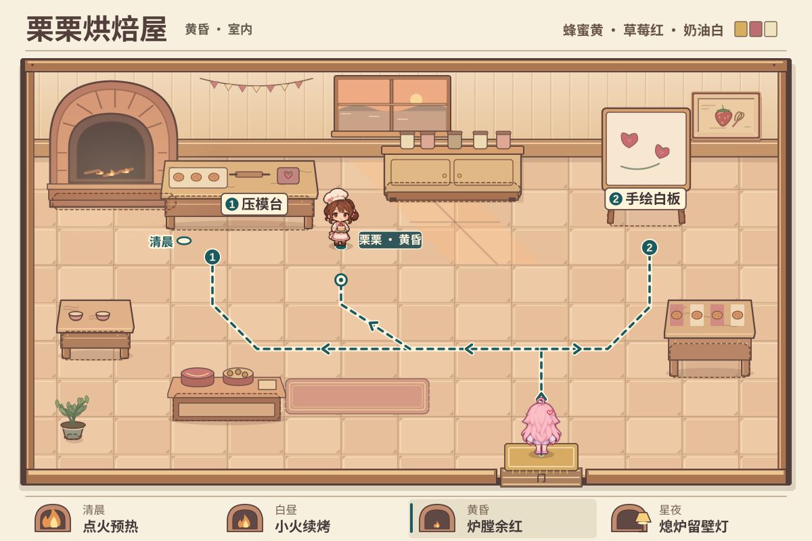
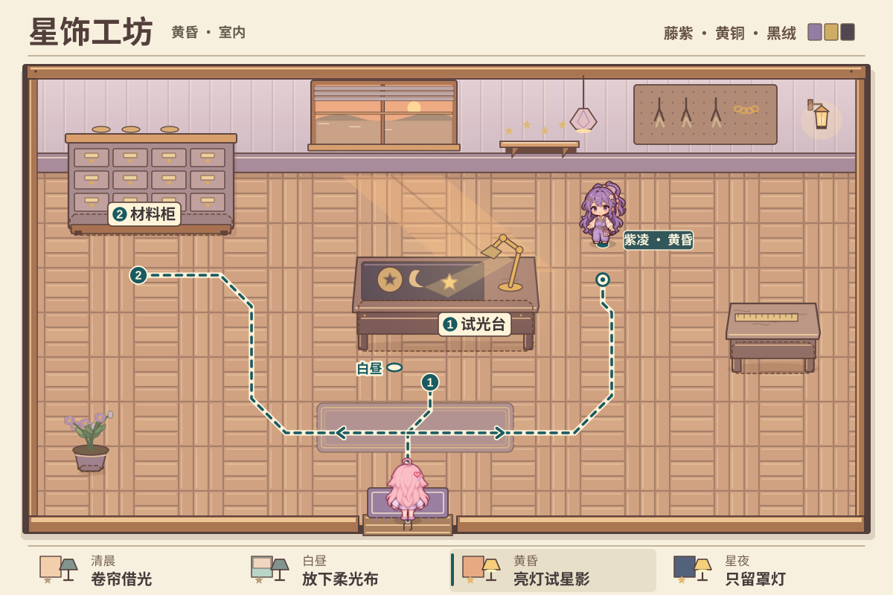
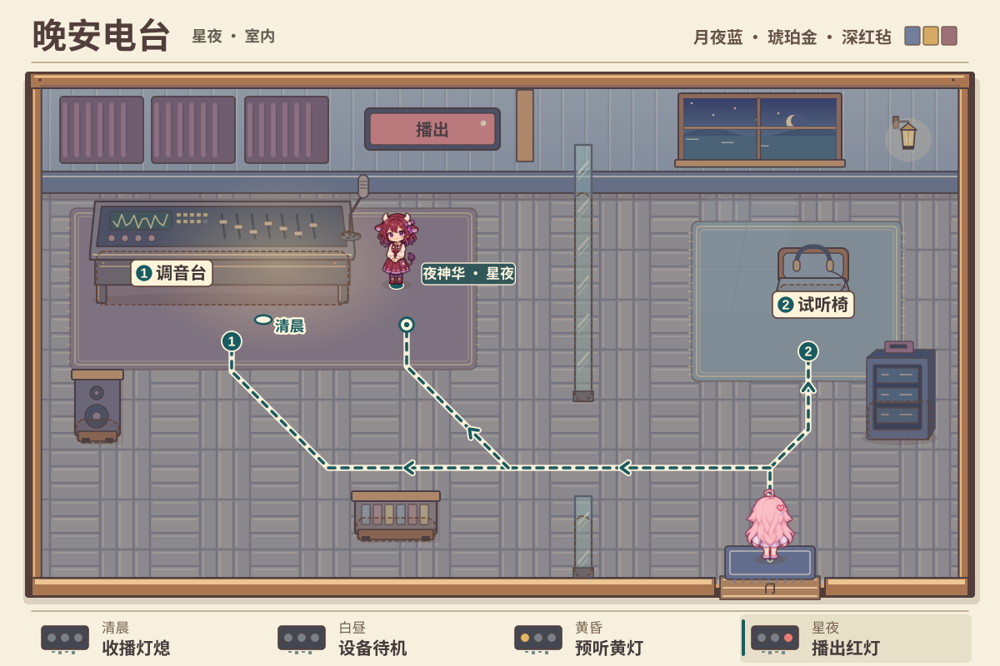
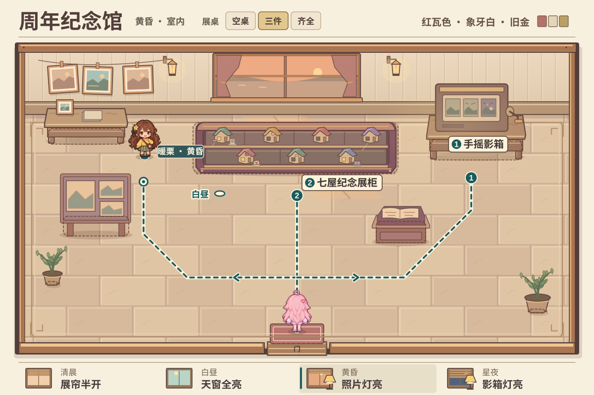

# 晚安周年小镇 · 七栋建筑的室内地图设计稿

七间屋子全天开放。芙芙可以在花店借一片落花，在邮局给自己盖一枚月牙邮戳，也可以第一次上北坡就进纪念馆。做好的小物收进背包的 **纪念物 → 小镇小物**。馆里的模型展桌会记下每件小物来自哪扇门。

每张图都是一张可独立打开的室内草图。**点图可放大。在浏览器单独打开 SVG 原图后，点图底的清晨、白昼、黄昏或星夜**，可以对照同一间屋子的窗扇、炉火、灯光和居民位置。文中的内嵌图显示代表时段，图底四幅小样可直接对照。纪念馆图顶还可以切换收藏数量。

## 读图与游戏时钟

- 七图共用 **600 × 400** 逻辑坐标，北墙在上，朝南的一面剖开。门垫上的芙芙取自游戏背向站立帧，身高约 43 个地图像素。居民使用各自的原立绘，桌面、椅背、炉口和窗台都以她们的身高定位。
- 青色虚线是从门垫出发的步行路线。**①** 对应主互动，**②** 对应另一处可查看的东西。物件名牌和地面上同号的圆点配对，圆点是芙芙实际停步的位置。人物旁的靶心是独立的交谈点，写着时段的空心椭圆标出这位居民另一班的站位。棕色点划线沿桌脚、柜底和隔断在地面的占地绘制。
- 人物与台柜、阅读椅和展桌按接地位置排序。脚底在物件后方时保留上方轮廓的遮挡，走到前方时人物盖住它。花店隔断和电台玻璃只在底轨处挡脚。玻璃保留透光，隔断开口处可完整看见经过的人物。窗光和灯影铺在场景上，提示和对白绘于上层。
- 沿用世界时钟。清晨为 05:00–08:00，白昼为 08:00–17:00，黄昏为 17:00–20:00，星夜为 20:00–次日 05:00。进门和读档时直接呈现当下时段。自然换班时，窗光与地板投影随现有昼夜过渡，窗扇、炉膛和灯牌各完成一次状态切换。开启减少动态效果时直接显示终态。
- 首次做完 ①，收下一件小物。再来可以重做、重听或重看成品。操作中的窗扇、炉具和试听设备先完成玩家眼前的动作，收起后回到**此时**的状态。七件都可以在居民外出时取得。

## 青芽花店

鼠尾草绿的窗框从街上的青瓦延伸进店里。西侧温室铺浅绿砖，主屋是干燥的木地板，两种地面在隔断的宽口相接。黄昏的青芽站在压花台左侧，给芙芙留出正面的操作位置。

**① 压花台 · 窗光花签**　拿一片自然落下的洋桔梗花瓣，夹入透光纸，合上木压板。举起抽出的花签，能看见细细的花脉。青芽初见时赠送的整束洋桔梗另有自己的赠语和收藏位置。

**② 温室气窗**　轻推窗把，听黄铜小铃碰响，看叶影扫过花桶。清晨窗扇大开，玻璃上留露珠。白昼放下半截遮帘，黄昏把窗收至一道缝。星夜扣好窗闩，花架旁亮一盏暖灯。夜里也能推开看一眼，再轻轻扣好。

| 与青芽交谈 | 台词 |
| --- | --- |
| 清晨开场 | “早。你托一下这片叶子，我来推窗。看，露珠顺着叶尖跑到你这边了。” |
| 黄昏开场 | “把花瓣往窗边挪一点。刚才还像一小团紫，迎着光，连最细的那条脉都看得见。” |
| 熟客话题一 | “我小时候压过一朵特别大的花。书合上以后鼓了三天，我娘一眼就猜到是哪本。” |
| 熟客话题二 | “这张纸我特意留了个小角。你用两根手指捏这里，举起来就不会遮住花了。” |

## 栗栗烘焙屋

蜂蜜黄的砖拱包住炉口，奶油色案台紧接出炉的位置。左手能看饼干成形，右手能看栗栗画它的模样。她留给芙芙的第一块草莓蛋糕继续走原有的举板、预留和品尝剧情。

**① 压模台 · 草莓饼干铁盒**　在面片上压下草莓模，推入小烤盘。炉铃翻牌后把第一盘小饼装进铁盒。星夜使用时，砖炉会为眼前这一盘短暂升温，装盒后回到熄炉状态。

**② 手绘白板**　翻板看栗栗的两张速写。清晨是大小不同的面团，炉膛里火苗最高。到了白昼，案台明亮，炉口缩成小火。黄昏铁盘收起，白板多了两颗烤歪的草莓，炉膛剩下红光。星夜能看清炉灰，东墙的灯仍照着白板。

| 与栗栗交谈 | 台词 |
| --- | --- |
| 清晨开场 | （栗栗用手比出一个小圆，又在白板上画了一个大圆。她指指炉门，在两个圆中间添上一支胖箭头。） |
| 黄昏开场 | （栗栗把最后一只盘子摞好，翻出白板。画上的草莓歪向一边，她端详片刻，自己也把帽子歪向了那边。） |
| 熟客话题一 | （栗栗举起一只饼干模。芙芙从中间望过去，正好框住她一只眼睛。白板上慢慢冒出三个字，“看见啦”。） |
| 熟客话题二 | （栗栗把铁盒盖轻敲两下，在白板上画了两枚音符。芙芙跟着敲了一下，她笑着补上第三枚。） |

## 星饰工坊

屋外紫藤的颜色用在软帘和灯罩上。中央工作台铺黑绒，黄铜的亮边在上面一眼可辨。抽屉柜摆在西侧，岛台四周留有通路，客人可以从南侧看试光。

**① 试光台 · 透星铜片**　转动有星形孔的铜片，观察投影沿黑绒移动。星尖落入月牙凹槽时，台灯照出完整图形，铜片便可收下。转过头了可以直接转回来。

**② 材料柜**　拉开抽屉，并排看磨过与尚有锤纹的黄铜。清晨卷起百叶借天光，白昼放下柔光布，抬起铜片能看清磨痕。黄昏试光灯亮，星影落在黑绒上。星夜只留工作罩灯，来人仍能试光。

| 与紫凌交谈 | 台词 |
| --- | --- |
| 白昼开场 | “来，借你这边的光。柔光布一放，铜片上哪一圈还没磨匀，眼睛马上就知道了。” |
| 黄昏开场 | “Perfect！站这儿看，台灯一亮，星尖刚好落进月牙。你再转一下，我跟着你的手调灯。” |
| 熟客话题一 | “这只抽屉最会骗人。拉开时叮叮当当，听着像一柜子宝贝，数来数去就三颗扣子。” |
| 熟客话题二 | “试试看，把星星投到我袖口。再抬一毫米——好啦，今天这件围裙也算定做过了。” |

## 周年邮局

墨绿柜台在尽头拐一个弯，侧边的开口让红笺和客人可以走到同一张工作桌。信格用黄铜小牌区分邮路，瓦红色的手柄提示哪里可以盖戳。

**① 邮戳机 · 月牙邮戳明信片**　挑一张预印的小镇风景片，将邮票角送到戳下，压下再抬起手柄。翻面能看到完整的月牙戳。风景片当场装入纪念物，红笺寄往晚安小屋的信按原剧情投递。

**② 分信格**　翻木牌看红笺这一班的邮路。清晨牌面翻到“晨邮”，指向出门的路。白昼抽屉敞开，格内露出待分的信。黄昏东侧的收件灯先亮，红笺在街上收信。星夜格柜合好，台灯单独照亮邮戳和待封的信。

| 与红笺交谈 | 台词 |
| --- | --- |
| 白昼开场 | “乖乖，帮我瞧瞧，这两封是不是去了同一条街？一个画的是红邮筒，一个画的是邮筒旁那盆花。” |
| 星夜开场 | “手搁这儿，灯光刚好。晚上盖最后一个戳，我总爱慢一点，好瞧清楚那弯月牙。” |
| 熟客话题一 | “第一次试这台机器，我把月亮盖倒了。收信的人回我一句，说谢谢我寄去了一只小碗。” |
| 熟客话题二 | “乖乖，拿张风景片试试。你看中哪盏街灯，就把邮票贴在它旁边，我替你把月亮添上。” |

## 相册书屋

装帧桌靠着西侧临池窗，芙芙能把折页举到水面前比一比。矮书架在东边围出有坐垫和茶几的阅读角。胡桃木、青绿书脊和池水蓝从桌面一直连到窗外。

**① 装帧桌 · 池畔风琴折页**　把晨光、午影、灯下三张池景沿折痕依次折起，再拉开。三段水岸连成一条线，最末一盏灯落在芙芙指尖。背包里也可展开重看。

**② 临池竹帘**　用伸向走廊的拉绳抬帘，看同一片睡莲此刻的颜色。清晨竹帘半卷，水纹落在窗座上。白昼卷得最高，池光伸进走廊。黄昏帘子放下一半，星夜垂到最低处，阅读角由一盏书灯照亮。若已收下折页，可把画中的岸线叠到窗景旁对照。

| 与墨桃交谈 | 台词 |
| --- | --- |
| 黄昏开场 | “君来得巧。趁斜光还看得清这道折痕，替我按住这一岸，另一岸便能接上了。” |
| 星夜开场 | “君且坐。方才读到一个‘静’字，窗外的鱼偏偏在那一刻翻了个身。” |
| 熟客话题一 | “有人问这三幅该从哪边读。我常从亮灯那头开始，慢慢折回去，便又逛了一趟清晨。” |
| 熟客话题二 | “君听过纸说晚安么？慢些合上最后一折。正是这一声，我日日等它收尾。” |

## 晚安电台

月夜蓝的窗框和深红吸音毡围出播音间。芙芙从东侧进门，在玻璃隔断南端绕到调音台。坐回试听椅，还能隔着玻璃看见播出灯和夜神华。

**① 调音台 · 晚安试播带**　选一段预制的溪水声或檐铃声，推起晚安片头的音乐，听完这一小段便可收带。台面同步显示声轨名称、电平和文字台标，静音也能完成。

**② 试听椅**　第一次戴上耳机听台呼，做完试播便可重听自己的片头。清晨台标换成“已收播”，电平落下。白昼显示“待机”。黄昏亮琥珀色“预听”，只有试音电平跳动。星夜红色“播出”亮起，两排电平随节目起伏。

| 与夜神华交谈 | 台词 |
| --- | --- |
| 清晨开场 | “我刚把推子拉下来，窗外那只鸟就接上了。它今天可真准点。” |
| 星夜开场 | “红灯亮了。芙芙，把左边这只耳机戴上，我想让你第一个听见今晚的开场。” |
| 熟客话题一 | “刚才那点沙沙声你也听见了？……呀，小牛角上的丝带又蹭到话筒了。” |
| 熟客话题二 | “刚才留了两拍没说话，想着你会坐过来。你真来了。那这两拍我想留在带子里。” |

## 周年纪念馆

红瓦色展帘下挂着筹备时的速写。暖栗以摄影来宾的身份在这里选片、挂照片。正门所在位置落在现有建筑碰撞内，入口设在**馆东石阶上平台**。从北街沿石阶上去，在侧门牌前进馆，出馆回到同一级平台。

**① 手摇影箱 · 亮灯夜票根**　摇动手柄，依次看见空广场、挂上彩旗、街灯初亮三格速写。转完一圈，从箱侧取票根。把纪念馆作为第一站也能收下它。

**② 七屋模型桌**　屋模照镇上方位摆放。西北是花店，北面是烘焙屋和坡上的纪念馆，东边是工坊。邮局、相册书屋、电台从西往东排在南半边。清晨展帘半开，白昼整扇高窗透光，黄昏先亮照片墙的灯，星夜再亮影箱内灯。模型窗口依据已收下的物品点亮，四个时段都可查看。

| 展桌样稿 | 可见内容 |
| --- | --- |
| 空桌 | 七栋屋模都已摆好，七扇窗是暗的。芙芙可以直接走到影箱摇出第一张票根。 [查看空桌](town-interiors/hall.svg#dusk-empty) |
| 三件示例 | 花店、邮局和电台三扇窗亮。窗前分别多出花签、明信片、试播带的小复制件。此时收下馆内票根，第四扇亮的是北坡纪念馆。 [查看三件](town-interiors/hall.svg#dusk) |
| 七件齐全 | 七扇窗各亮一盏，每栋屋前都摆出自己的小物。星夜从展桌南端能看到完整的微缩小镇，原件仍在芙芙的背包里。 [查看七件](town-interiors/hall.svg#night-full) |

| 与暖栗交谈 | 台词 |
| --- | --- |
| 白昼开场 | “芙芙，帮我选张照片挂上去吧。这两张就差半步，右边那张能看见你裙角从街口拐过去。” |
| 黄昏开场 | “等一下，照片还歪一点……好了！快站我这边看，纸上的路灯和窗外那盏刚好接在一起。” |
| 熟客话题一 | “我以前拍广场，总等大家都走开。刚才翻底片才发现，最舍不得收起来的那张里，每个人都在忙自己的事。” |
| 熟客话题二 | “这回你来当摄影师。你要是数到三，我一定会眨眼。要不咱们数到二就拍？” |

## 人物换班与重访

| 居民 | 清晨 | 白昼 | 黄昏 | 星夜 |
| --- | --- | --- | --- | --- |
| 青芽 | 温室开窗 | 花店外 | 屋内压花 | 休息 |
| 栗栗 | 炉边开炉 | 烘焙屋外 | 屋内收盘 | 休息 |
| 紫凌 | 工坊外 | 试光台前打样 | 东侧试灯 | 休息 |
| 红笺 | 街上送信 | 局内分信 | 街上收信 | 局内封晚邮 |
| 墨桃 | 书屋外 | 休息 | 装帧桌边 | 阅读角夜读 |
| 夜神华 | 电台收播 | 休息 | 街上听溪声 | 电台播音 |
| 暖栗 | 街上晨拍 | 馆内选片 | 馆内挂照片 | 街上夜拍 |

门牌写出当前去向，例如白昼在花店门口能读到“青芽在东边花阶”，黄昏则是“青芽在压花台”。玩家在场时，换班的居民先走到门槛再跨场景，人物、交谈提示和脚底碰撞随人一起交接。正在聊天时保留人物和这一段对白，收起或走远后再换班。已在别处推进时间，进门时便采用当前班次。

屋内外共用人物的相识和赠礼记录。初见、青芽尚未送出的花束、栗栗预留的第一块蛋糕、红笺的投递和夜神华尚未递出的信，依原角色剧情优先接续。进入日常后，每个在场时段第一次闲聊读该时段开场，再次发起分别读熟客话题一、二，随后轮回。返回聊过的时段时接着该班的进度，若刚在另一班听过同一条熟客台词，就轮到下一条。翻页和连点同一段只算一次，刷新后接着已记下的进度。

## 进出门与步行验收

门外两列使用 1536 × 1024 小镇坐标，其余列使用各自的 600 × 400 室内坐标。商铺可朝北跨过正门门槛，也可按 **E**、点击或轻触门。纪念馆的入口是东侧石阶上平台的小木牌，走到牌前按 **E** 或点牌进馆。进屋落在门垫上并面朝北，出门回到同一扇门的街道侧落脚点。室内从门垫向南走到 y = 352 出门，也可点击门垫南侧的出口。南墙两侧挡脚，只有门洞可通过。自动切图只处理朝门外或门内跨过线的一步，站在落脚点和沿门前横向经过时照常通行。

| 建筑 | 街道侧落脚 | 正门门槛或门牌 | 室内门垫 | ① 主互动停步 | ② 次互动停步 |
| --- | --- | --- | --- | --- | --- |
| 青芽花店 | (258, 242) | (258, 232) | (321, 336) | (458, 214) | (97, 179) |
| 栗栗烘焙屋 | (711, 244) | (711, 237) | (400, 336) | (157, 190) | (480, 183) |
| 星饰工坊 | (1213, 403) | (1213, 395) | (274, 336) | (289, 257) | (93, 185) |
| 周年邮局 | (253, 627) | (253, 621) | (148, 336) | (475, 252) | (94, 172) |
| 相册书屋 | (852, 767) | (852, 756) | (305, 336) | (141, 184) | (75, 245) |
| 晚安电台 | (1337, 829) | (1337, 824) | (462, 336) | (139, 205) | (485, 211) |
| 周年纪念馆 | (1188, 54) | (1178, 49) | (300, 336) | (476, 180) | (300, 254) |

草图按游戏的脚底半径 5 验线。新落脚点和门槛之间留一步，书屋回到台阶西侧，和墨桃的巡走路线错开。把当班人物放进草图后，从门垫走到两个操作点和独立交谈点，再原路走到门槛。另试走南墙、柜台、桌脚和两处玻璃隔断的实体部分。纪念馆的模型灯窗按空收藏、三件和七件复核，每扇亮窗对应一件复制品。

美术取色对照小镇屋顶与店招，室内比例取自晚安小屋。草图中嵌有项目的芙芙、镇民和夜神华立绘，柜台、模型、家具与光照为本稿绘制。 [周年小镇底图](../../src/assets/anniversary-town-v13.webp) · [晚安小屋底图](../../src/assets/room-interactive.webp) · [居民美术记录](ARTWORK-residents.md)
