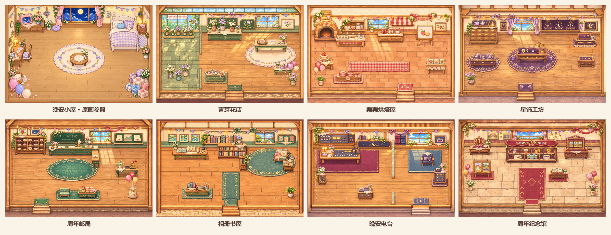

# 小镇七间店铺 · 白昼室内效果图

左上角是晚安小屋原画，其余七格是店铺重绘效果图。点开总览可比较整组画面，表中的店名通往各自的 1200 × 800 PNG。

[](overview.png)

| 单张原图 | 场景细节 |
| --- | --- |
| [青芽花店](florist.png) | 玻璃温室的通道通向压花台，桌上有透光纸和洋桔梗。 |
| [栗栗烘焙屋](baker.png) | 砖炉、草莓压模和手绘白板分列在北侧。 |
| [星饰工坊](maker.png) | 试光台四周可绕行，灯下的黄铜星月落在深色绒面上。 |
| [周年邮局](post.png) | 墨绿柜台向右折，红色手柄标出盖月牙邮戳的位置。 |
| [相册书屋](books.png) | 后窗能看见树冠与青瓦屋顶，南侧台阶接上石板街。 |
| [晚安电台](radio.png) | 透过隔音玻璃能看见调音台，南侧留出通往试听椅的开口。 |
| [周年纪念馆](hall.png) | 沿中央地毯能看到上四下三的展柜，右边是手摇影箱。 |

## 与游戏地图对照

七间均取当前地图的白昼构图，以晚安小屋的家具比例、木作和布艺为参照。出图时按 600 × 400 地图坐标叠加芙芙背向立绘、两班居民站位、原步行路线和家具占地，再以 320 像素宽逐间检查通道。邮局墙牌沿用游戏里的「寄一封晚安」。

相册书屋按看图反馈移除了左墙的斜门和地板投影。游戏中的竹帘装在北墙临街窗上，走到后窗可卷帘，收下池畔折页后可在窗边展开对照。

## 内置 ImageGen 提示词

<details>
<summary>星饰工坊样板架的接地修整</summary>

样板架按地图占地缩放后，用下列提示修整柜脚外露出的地板。

```text
Use case: precise-object-edit. This square crop is part of a larger hand-painted RPG jewelry workshop floor. Fix the small visible editing artifact on the wood UNDER the UPPER purple jewelry sample cabinet. Leave both cabinets, displays, positions, rug, flower vase, small real feet and all four outer edges of this tile exactly as drawn. In the horizontal strip immediately under the upper cabinet, particularly from x=18% to x=88% and y=54% to y=66%, remove the dark freestanding U-shaped rectangular shadow/ghost, duplicated short seams, and smudged patches. Replace them with seamless, straight, regular honey-oak FLOORBOARDS that precisely continue the plank courses from the left and right edges, naturally varied wood grain, and ordinary warm daylight. No border enclosing the retouch. The only cast shadow from the little upper cabinet is a SHORT soft contact shadow directly touching its little feet and rug, a few pixels. The floor between the two pieces of furniture should be clean plain timber, no new objects, no extra rug, no extra shadows. Same camera, scale, palette, furniture boundaries, position and canvas framing. No text or marks.
```

</details>

每间先使用对应的白昼布局图与同一张小屋美术参考图。参考图含小屋全景、家具局部和花园花草。下列共用提示分别接上各店文字，组成七次独立的出图指令。

<details>
<summary>七间店的首轮提示词</summary>

**共用提示**

```text
Use case: style-transfer. Produce one finished, landscape 3:2 in-game interior background for Fufu's cozy anniversary town, viewed from exactly the same fixed orthographic, slightly overhead front camera as the supplied map. This is a playable RPG room, a single edge-to-edge illustration with no presentation border, labels or panels.
Image 1 is the exact spatial blueprint: register the back wall/floor join (y≈29%), building sill (y≈87.5%), rugs, open walkways, doorway and every piece of grounded furniture to their same positions and widths. Read positions as measured from the TOP LEFT of the whole 3:2 image. Draw the furniture in place, with believable thickness, small legs and 3D-painted tops, while keeping the visible foot/base at its reference coordinates. Keep the entrance mat and steps on the SOUTH/bottom edge at the specified x even when off-centre. The narrow margin below the sill is the small exterior apron. Preserve quiet floor between objects; do not fill walkways with new freestanding props. Pull the frame back into delicate wooden wall posts, baseboards and a low threshold.
Image 2 is the owner's actual cottage game art and detail swatches: match its intimate Japanese cozy RPG hand-painted pixel illustration, fine warm sepia edgework, precise pixel clusters and carved highlights, sunny cream walls, warm natural oak, soft grounded shadows, restrained worn wood grain, tiny plump botanical and textile details, short chibi-scale furniture proportions. Crisp, colorful and clear at game size with confident value separation. A clear bright midday view with natural window-shaped light, luminous subtle highlights and soft-edge directional shadows. Use the cottage image for technique, not its furniture or nighttime sky. Give each shop thoughtful specific detail in small local groups on existing cabinets. No people, silhouettes, UI, watermark, writing, extraneous numbers, marks for navigation, or arrows. No perspective vanishing point, fisheye, roof, top-down floor plan, faded wash, blurry airbrush or flat vector rectangles.
```

**青芽花店**

```text
QINGYA'S FLORIST. Lead with freshly cut lisianthus: recognizable milky ivory and pale lilac ruffled bells, varied sepals and fine stems in glazed honey terracotta pots; a few tiny pink ribbons connect to the garden. Warm honey timber main room, sage-painted greenhouse frames and muted small green stone floor on the LEFT 30%. Leftmost north greenhouse plant shelf ends at x26%, directly below the vent crank. A NORTH-SOUTH slim transparent greenhouse screen at x30% has TWO separate edge-on segments and an OPEN transverse passage at y51–71%; do not close it. Keep the open floor at x16%, y45% where the window is operated. Long flower counter at back x35–58%. The important freestanding press table at x68–88%, FEET y41–48%, near the east, holds a small wooden flower press, translucent paper rectangle and two pressed petals, sunlight falling through leaves onto the paper. Carved scallop-edge rug lies flat below this table. Three flower buckets low down on the left; tiny wrapping bench x35–46%, base y78%, clean ribbon side table x81–92% base y71%. South entrance mat center x53.5%, y84%; wildflowers grow only on existing furniture or along the window, never in the passage. Show a lovingly tended warm working flower shop, richly painted blossoms at focal points, breathing space on the floor.
```

**栗栗烘焙屋**

```text
LILI'S STRAWBERRY BAKEHOUSE. Honey biscuit wood, cream worktops, biscuit terracotta floor tiles, accents from the strawberry-red and ivory striped awning. Distinct golden brick arched oven, a dark vaulted mouth with a SMALL daytime ember, iron hearth lip and staggered fired bricks, on northwest left x6–22%, base y39%. Right beside it the flour-dusted low worktable x20–39%, feet y42.5%, a strawberry outline cookie cutter, a crumb of pastry dough, a little rolling pin. Centre-rear cupboard of labeled-looking but unlettered jars x47–64% ends y37%. The pale freestanding wooden easel whiteboard northeast x75–84% ends y42%, with a simple tiny strawberry-and-cookie drawing (no words). Cake tasting stand x8–16%, feet y66%, with a miniature single-tier strawberry sponge under a lifted corner of strawberry gingham; existing eastern return/display stand x82–93%, feet y70%. Biscuit packing table with twin tins x21–35%, feet y78%; tiny southwest herb pot. Keep the broad centre free for walking, a narrow worn red gingham runner flat across it. The entrance mat and step are off-centre at x66.7%, y84%. Make the brick oven and sugar/flour details delightfully tactile.
```

**星饰工坊**

```text
STAR JEWELER'S WORKSHOP. Wisteria curtains, aged brass, polished medium honey oak and a plum-charcoal velvet top, not an all-purple room. The eye goes straight to a SMALL CENTRAL FOUR-LEGGED LIGHT TEST BENCH x40–60% (20% of image width), feet occupy y51–59%. Face the viewer; individual brass star perforation, slim crescent alignment groove on the velvet, curved brass task lamp. A flat embroidered plum rug under the table; generous walkable ring at all four sides. Northwest a true many-drawer material cabinet x8–26%, foot at y39.5%, knobs as little oiled wood buttons and brass labels. A separate western, low glazed finished jewelry case x10–25%, foot at 64%; do not merge with the drawer chest. East-wall moon, star and kite sample rack x80–92% touches y42.5%, eastern measuring cabinet x82–91% touches y63%; small southwest pot. Flowering wisteria comes from the street's purple awning in the form of dyed soft curtains and a small hanging sprig. South entrance mat x45.7%, y84%. Preserve the open floor right in front of the central bench. Brass catches crisp warm pinpoints under daylight from a rear window.
```

**周年邮局**

```text
ANNIVERSARY POST OFFICE. Honey-colored wood, cream daylight, deep ink-green enamel and the vermilion of the outdoor post box. Keep the exact L counter plan: long horizontal writing counter along the back from x30–63%, foot y36.5%, with a short narrow return running DOWN only at its RIGHT end x60–63% to y49%; east of the end stays open. Northwest letter sorting cabinet x7–27% foot at y36.5%: real pigeonholes with a few cream and rose envelopes, warm brass label holders; unlettered. Mid-east workdesk x76–89%, feet y53–59%, a hand-operated brass crescent postmark press with a prominent lacquer RED lever, ink pad and a wax-sealed postcard. Lower-centre left of x44% a small waiting seat, adjacent to a separate tied parcel chest centred x55%, both feet y80%; tied postbag at x86%, base y79%. An oval teal woven rug lies flush under the L counter with an envelope stitched into its border. South doorway deliberately far LEFT at x24.7%, mat y84%. Clean broad crossing to the stamp and mail slots. Give the counter carved edges and panel depth and the paper fiber, seals and quiet green surfaces distinct materials.
```

**相册书屋**

```text
POND ALBUM BOOKSHOP. A quiet bookbinder's room with honey wood, sea-green trim, cloth-bound albums, cream paper and a blue-green hint of daylight water. A real narrow WEST-FACING SIDE-WALL window in the far left wall between y37–63%, shown at a slant in the same footprint, a rolled-up bamboo shade on the top, small hanging pull at x10%, y55%, pond shore and water lilies visible through the GLASS. Not a standing framed picture in the aisle. A restrained reflection of the ripples falls across a sheet on the nearby binding desk x13–33%, feet y41.5%, with a folded accordion sheet, linen cord, bone folder and ink. Middle low bookcase x42–62%, ends y40%; short return shelf near x59% down to y52%, leaves the east reading nook accessible. East reading chair x83–89%, base y43% with a soft rumpled blanket, small tea table x88–92% ends y53%; both on a flat faded teal floral rug. Small crate of unfinished clothbound books x21–35% ends y78%; tiny southeast plant. Bottom entrance x50.8%, mat y84%; runner from door to the open floor. Light, not dark-academic. Warm creamy wood pages, tiny individual book spines, graceful cushioned chair and quietly sparkling water.
```

**晚安电台**

```text
GOODNIGHT RADIO STUDIO in bright MIDDAY. Beautiful vintage woody recording room with a honey oak board floor, moon-indigo window frames and chair, restrained dark berry felt baffles. Make it unmistakably a radio recording booth. The western engineer desk at x10–35%, feet y38–46%, sits on a berry rug; the honey wood mixing console has cream fader caps, warm amber analog standby VU meters, a well-shaped vintage broadcast microphone on an arm near its right corner (x35%). A tiny discreet standby lamp. East listening booth chair at x78–85%, feet y43–47%, built of navy/indigo fabric, berry piping, oak arms, headphones; flat soft blue rug. A THIN north-south acoustic glass partition runs edge-on at x58.3%: there are TWO separate segments with a wide, completely OPEN CROSSING centered at y70% between the back and the front stub; avoid a closed booth or crosswise wall. Localized reflections only, see the opposite mic behind the glass. West side speaker at x10% ends y66.5%, cassette chest x36–44% ends y81%, east equipment rack x87–93% foot y66%. Keep the broad passage between the desk and east chair. Bottom entry decidedly to the RIGHT at x77%, mat y84%. Clear natural blue-sky daylight with soft warm desk reflections. No red on-air signal.
```

**周年纪念馆**

```text
FUFU'S FIRST ANNIVERSARY MEMORY HALL. Elegant walnut joinery, claret velvet exhibit curtains, ivory stone and fine aged brass, sweet village-scale. Deep red central runner, from the centered southern entry x50%, y84% to the front of the north exhibition case; straight open central aisle. Hero object is the north-wall walnut curio case x32.5–67% of frame, base y44%, its lower glass elevation has exactly TWO shelves with seven discernible collectibles: TOP row FOUR bays, left to right pressed flower bookmark, small strawberry biscuit tin, small amber ticket stub, brass perforated star token. BOTTOM row THREE wider bays, left to right wax-sealed postcard, folded accordion water landscape, cassette tape. 4 above, 3 below, no extra cubbies. Separate hand-cranked picture theatre cabinet on the RIGHT x72.5–88%, foot y40.5%; tiny town vignettes under glass, visibly projecting brass handle with wooden grip at its right side. Left anniversary badge case x8–21% foot y36.5% and small town street print easel x11–22% foot y60%; open anniversary album stand mid-right x63–72%, foot y61.5%, tiny side plants. The existing large plaque above the main display can carry a tasteful carved ribbon, brass one-year motif or botanical crest. The stage is the cabinetry, sunlit warm-red fabric and mementos; airy bright ordinary daylight, not a grand dark ballroom.
```

</details>

<details>
<summary>花店、烘焙屋、书屋与电台的局部调整</summary>

每次使用首稿与小屋参考图。共用提示后接对应店铺的调整文字。

```text
Use case: precise-object-edit. The first attached art is a finished game map to retouch, the second is the game's cottage style reference. One complete 3:2 landscape opaque game background. Preserve the exact camera, framing, edges, palette of the furnishings, location and size of every grounded object, BOTH bottom steps and mat position, and ALL vacant walking space from image 1. This is a production geometry-locked edit. No repositioning, zoom, text, UI, people or caption. Match the cozy hand-painted original cottage's restrained crisp warm outlines, lighter friendly colors, small natural details and readable shapes in daylight. Only the specified surface decorations or architectural treatment are being retouched.
```

**青芽花店**

```text
At the top of the room, replace the heavy straight picture-frame band/mitred corners ABOVE the existing pennants with a convincing narrow glazed greenhouse transom: very slim sage-painted wooden muntins and clear pale daylight with delicate vine leaves at the ends. This should merge into the greenhouse on the left and a natural plaster header with a slim oak beam on the right. Keep the bottom threshold and all foot positions exactly still. In the SMALL EMPTY dark green wall plaque between the herb cabinet and right-hand window paint a very fine gold-outline single pressed lisianthus sprig and a curling botanical ribbon, no letters. A soft leaf-shaped glint can fall across the translucent paper on the press table. Preserve the two separated glass segments on the left with the actual gap at y60%.
```

**栗栗烘焙屋**

```text
Change just the high top wall, currently a huge horizontal wooden frame between the upper corners, to a warm cream plaster frieze with narrow honey molding. Above the brick oven only, let a few honey brick courses of the oven chimney continue into the frieze. Daylight picks up a few soft plaster irregularities; keep it understated with plenty of quiet cream. Keep the upper bunting below that frieze. On the flour-dusted worktop make the small metal cutter visibly a STRAWBERRY outline, with three tiny stalk leaves at its top. Keep the existing front of the oven, tiny flame, jars, whiteboard, tabletops, gingham, threshold, positions and room geometry unchanged.
```

**相册书屋**

```text
The left-hand pond window currently resembles a portable framed picture standing on the floor. Paint a shallow, believable LEFT side-wall return within the existing leftmost 10% of the image; set the existing pond window into that wall, tied directly to its wooden jambs and sill, with the same exact footprint and high rolled bamboo slats and a right-side pull cord at x10%, y55% of the full image. Make the sideways view through the glass one connected pond vista with lily pads, a sliver of stone bank and reflections, not the same floral picture repeated in every pane. Draw a very subtle sweep of blue-green light and sun ripples that grazes THE LEFT binding desk's cream folding paper right next to it, and fades across the adjacent floor. Over the north bookshelves replace the thick mitered wood-frame header of the original with a shallow bookbindery loft wall with cream plaster and a few thin wood uprights, keep the hanging pennants and daylight. Keep the ENTIRE original floor clear in the walking lane between window and book stand. Preserve the bound books, west desk, right reading chair, warm daylight, door mat and all furniture locations and proportions as in image 1.
```

**晚安电台**

```text
Repaint only the topmost thick wood frame above the existing pennants as a narrow strip of honey-toned slatted acoustic ceiling soffit in a shallow cream wall recess, with ends disappearing into wall posts. Some warm wood, some indigo/raspberry cloth; more like an intimate radio room and less like a timber picture frame. Give the camera-facing BLANK INDIGO plaque in the middle of the back wall a tasteful fine gilt crescent-and-radio-wave emblem with small dot markers, visible and centered, pictorial only without lettering. Keep daylight sky, western console, amber analog standby dials, microphone, both thin vertical glass segments and their open southern crossing, eastern listening chair and all other objects exactly as supplied. Keep the chair's feet close to the base in reference and the passage empty.
```

</details>

<details>
<summary>相册书屋的街景、门前铺石与左墙定稿</summary>

换景参考了游戏里相册书屋门外的石板路、屋顶和花篱。铺石和左墙各使用一张标出修改区域的参考图。

**后窗与门外街景**

```text
Use case: precise-object-edit. Retouch the FIRST attached 3:2 landscape complete bookbinding shop interior, the specific image the owner is reviewing. The SECOND image shows the actual dry town street around this shop, only a reference for what one sees OUTSIDE. The shop is ON DRY LAND in the village in bright, ordinary midday. Make a strictly localized, visually obvious change to the outdoor views and the light they cast.
1. BACK WALL, upper right: in the existing four-pane wooden window, REPLACE the entire old aquatic picture with ONE continuous eye-level land view. Clear pale ordinary sky with one soft cloud on the top third, leafy spring tree crowns and a small neighboring warm-cream cottage gable with a terracotta or teal shingle roof in the lower two thirds. All four panes look into the SAME little street; no repeated scene or object per pane. Keep the brown mullions and sill.
2. LEFT glazed doorway with its rolled bamboo shade: through its panes we distinctly see dry cream cobblestones receding along a little lane, a low natural wooden garden fence, sunlit greenery and a few pink flowers, as seen in reference 2. Visible solid dry GROUND, a natural horizontal line and true depth. The south/foreground doorstep also opens onto a small strip of that same warm DRY paving along the bottom of the image. Keep the threshold and the centered three steps exactly the same size and position.
3. Replace the rippling water-caustic pattern on the indoor wood floor beside the left door with a quiet warm rectangular patch of ordinary sun and just the gentle straight window-mullion shadows. Keep the fiber of the wooden boards clear and dry. Every exterior view is above land, no water, lily pads, fish, cool blue-green cast, or watery web of light anywhere outside the small framed wall illustrations. The three framed art prints and album are indoor paper art and may remain as in the original.
Everything else remains precisely registered to image 1: camera, framing, book cases, binding desk, reading chair, rugs, wall decor, clean walkways and same cozy hand-painted cottage-game style. No new freestanding furniture, people, writing or UI. Output the single complete corrected room at the original 3:2 composition.
```

**台阶外的石板**

```text
Use case: precise-object-edit. Produce the exact same finished 3:2 game art as image 1, with the narrow ground OUTSIDE the bottom/south threshold painted as a DRY STONE LANE. Image 2 is the identical image with a vivid magenta mask identifying exactly which small strip to repaint. REPLACE ALL MAGENTA REGION SHAPES with a shallow sunlit town sidewalk of small warm cream and honey-tan irregular hand-laid cobbles, with fine shaded mortar seams drawn to the same game scale and a small cast shadow beneath the existing oak sill and timber doorstep. Paving continues in front of the last stair. A few tiny pink fallen petals from the garden at the far edge. Image 3 is the actual bookshop street for paving style, hue and stroke only. Keep every piece of the bookshop interior from image 1 exactly stationary and pristine, including the ordinary clear sky and teal gable through the rear window, the dry flower lane through the left glazing and normal sun/shadow patch on the floor. Respect the NOTCH of the mask: keep the original central three wooden steps, green door mat, existing posts and leading sill as they are. Only the PAVEMENT BELOW the front sill changes. Return the single final room, full original bounds with no guide color, no text/labels, people, extras or montage.
```

**移除左侧斜门和投影**

```text
Use case: precise-object-edit. Remove the entire LEFT side glass door/window and every trace of its projected light and odd inward perspective from this game room. Image 1 is the owner's approved dry-street bookshop with the unwanted left-hand door. Image 2 marks in magenta the region to reconstruct. Single complete opaque 3:2 image. In this region, COMPLETELY DELETE the left door, doorframe, green door panel, glazing, bamboo blind, pull cord, projecting sill, slanting wall, sunbeam and window-grid shadow on the floor. Replace with ordinary contiguous honey-oak floorboards, horizontally aligned with the existing plank seams continuing in from the right until they reach the slim, straight vertical timber post on the very left edge. At the top left extend the REAR cream wall and sage dado horizontally out to the left corner at the same height as the existing north wall. The left edge of the playable floor below this rear-wall junction should be calm, open and flat from back to front, not another tall narrow wall face projecting into the room. No new object in the exposed area. Wood has the same soft ambient light as the middle boards. NO patch of sunlight, reflected lines or door shadow in that patch. Do not replace the removed feature with any other door, side window, alcove, frame or blind.
Keep the real SOUTH doorway and its centered steps, dry sunny cobblestone forecourt, one existing north-wall window with its blue daylight sky and neighboring roof, the three framed pond paintings, bookbinding desk, all rugs, furnishings, visible floor opening, proportions, original camera and original picture bounds precisely as supplied. Match the existing game illustration's color, linework and wood texture. The finished image has only the normal top-right window and the southern entry. No magenta marks, labels, people, watermark or UI.
```

</details>
